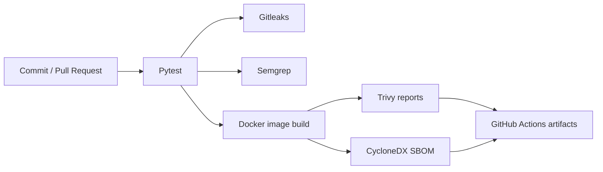

<div align="center">

# 🔐 SupplyGuard
### DevSecOps · Secure CI/CD · Software Supply-Chain Visibility

[](https://github.com/gaddah-yousef/SupplyGuard/actions/workflows/ci.yml)


**A small FastAPI application used to demonstrate security checks along a software delivery pipeline.**

[Features](#-security-workflow) · [Run](#-quick-start) · [Scope](#-scope--limitations) · [Portfolio](https://github.com/gaddah-yousef/SOC-LAB/blob/main/docs/portfolio/github-projects.md)

</div>

---

## 🎯 Why this project exists

A deployable application is not secure simply because its code works. SupplyGuard provides a compact example of combining **unit tests, code scanning, secret detection, image analysis and software bill of materials (SBOM)** in CI.

## 🧩 Security workflow



| Control | Purpose |
| --- | --- |
| **Pytest** | Check API behavior |
| **Gitleaks** | Look for accidentally committed secrets |
| **Semgrep** | Static analysis of source code |
| **Trivy** | Scan dependencies and container-image vulnerabilities |
| **CycloneDX** | Generate a machine-readable SBOM |
| **Docker** | Demonstrate containerized application packaging |

📂 [Inspect the CI workflow](.github/workflows/ci.yml) and its actual run history in the **Actions** tab.

## ⚡ Quick start

```bash
git clone https://github.com/gaddah-yousef/SupplyGuard.git
cd SupplyGuard

docker compose up --build -d
docker compose ps
curl http://localhost:8000/health
curl http://localhost:8000/products
```

Open the interactive API documentation at **http://localhost:8000/docs**.

## 📡 Demo API

| Method | Endpoint | Purpose |
| --- | --- | --- |
| `GET` | `/health` | Health check |
| `GET` | `/products` | Sample products |
| `GET` | `/products/{product_id}` | Sample product detail |

To run Python tests locally:

```bash
python -m pip install -r requirements.txt -r requirements-dev.txt
python -m pytest -q
```

## ⚠️ Scope & limitations

- This is an **educational DevSecOps demo**, not a production API or a verified security certification.
- Some Trivy workflow steps currently use `continue-on-error`; archived findings therefore **do not automatically mean the pipeline blocks all vulnerable builds**.
- The example Compose configuration publishes port `8000` without a localhost restriction. Restrict network exposure before running outside a trusted lab.
- The API returns demonstration products, not sensitive business data.
- Validate the actual CI run, image publication and runtime health before reporting outcomes.

## 👤 Author

**Yousef Gaddah** · [GitHub](https://github.com/gaddah-yousef) · [Enterprise SOC Lab](https://github.com/gaddah-yousef/SOC-LAB)
