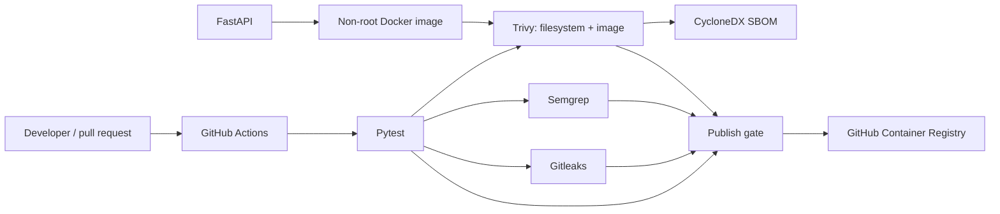

# SupplyGuard — Secure CI/CD & Software Supply Chain Lab

[](https://github.com/gaddah-yousef/SupplyGuard/actions/workflows/ci.yml)

**SupplyGuard** is a reproducible **DevSecOps training project** built around a small FastAPI application. It demonstrates how tests, static analysis, secret detection, container vulnerability scanning, software-bill-of-materials generation, and container publication can be assembled into a GitHub Actions pipeline.

> **Project status:** educational proof of concept, not a production product catalog or a fully validated supply-chain security platform. The badge reflects the latest GitHub Actions run; this README does not assert that every job currently passes.

## 1. Business and security problem

A CI/CD pipeline can deliver vulnerable applications or leak credentials if builds, dependencies and containers are not checked before publication. SupplyGuard provides an intentionally small service so the pipeline—and the reason behind each gate—can be inspected independently.

**Learning outcomes**
- Design a testable Python REST API and containerize it.
- Run automated quality and security checks on every push and pull request.
- Enforce a vulnerability gate for selected HIGH/CRITICAL findings.
- Generate an SBOM in CycloneDX format.
- Publish a container image to **GitHub Container Registry (GHCR)** after the required checks.

## 2. Architecture



The application exposes demonstration data only. It has **no user authentication, persistent database, deployment orchestrator or business payment logic**.

## 3. Technology stack

| Layer | Implementation |
| --- | --- |
| API | Python 3.12, FastAPI, Uvicorn |
| Tests | Pytest, FastAPI TestClient, HTTPX |
| Container | Docker, Docker Compose, non-root `appuser` |
| CI | GitHub Actions |
| Secret detection | Gitleaks |
| Static analysis | Semgrep |
| Vulnerability scanning | Trivy (filesystem and image) |
| SBOM | CycloneDX generated with Trivy |
| Package publishing | GHCR |

## 4. Repository structure

```text
SupplyGuard/
├── .github/workflows/ci.yml  # CI jobs and image publication
├── app/main.py               # FastAPI endpoints
├── tests/test_api.py         # API-level unit tests
├── Dockerfile                # Runtime image and non-root user
├── docker-compose.yml        # API service with health check
├── requirements.txt          # Pinned application dependencies
├── requirements-dev.txt      # Test dependencies
└── README.md
```

## 5. Running locally

**Requirements:** Docker Engine + Compose v2, or Python 3.12.

### Option A — Docker Compose

```bash
git clone https://github.com/gaddah-yousef/SupplyGuard.git
cd SupplyGuard
docker compose up -d --build
docker compose ps
curl http://localhost:8000/health
curl http://localhost:8000/products
```

API documentation: <http://localhost:8000/docs>.

**Security note:** `docker-compose.yml` currently publishes port `8000` on all host interfaces. Run it on a trusted workstation or bind it to `127.0.0.1` before use in a shared environment.

### Option B — Local Python

```bash
python -m venv .venv
# Linux/macOS: source .venv/bin/activate
# Windows PowerShell: .venv\Scripts\Activate.ps1
python -m pip install -r requirements.txt -r requirements-dev.txt
python -m uvicorn app.main:app --reload
```

### Run the test suite

```bash
python -m pytest -q
```

The tests inspect the health endpoint, sample product listing, successful numeric product IDs, and the FastAPI response to a nonnumeric ID.

## 6. API contract

| Method | Path | Purpose | Expected behavior |
| --- | --- | --- | --- |
| GET | `/health` | Health signal | `{"status":"ok"}` |
| GET | `/products` | Return sample catalog | Two demonstration products |
| GET | `/products/{product_id}` | Demonstrate path validation | JSON with requested integer ID |
| GET | `/docs` | OpenAPI UI | Interactive documentation |

**Important:** `/products/{product_id}` currently returns a placeholder for any valid integer rather than looking up a database record. This is deliberate for pipeline demonstration; it is not a realistic inventory API.

## 7. CI/CD explained

The workflow in [`.github/workflows/ci.yml`](.github/workflows/ci.yml) runs these jobs:

1. **Tests:** install dependencies, run Pytest.
2. **Secret scan:** Gitleaks inspects the repository history.
3. **SAST:** Semgrep runs the configured Python rules and archives a JSON report.
4. **Container scan:** build the Docker image, check dependencies and image using Trivy, archive JSON reports and a CycloneDX SBOM; fail on selected fixable HIGH/CRITICAL issues.
5. **Publish:** on a push to `main`, and only after the required jobs, build and publish versioned/`latest` image tags to GHCR.

The SAST stage **collects findings but is not configured as a strict finding-based security gate**. The report should be reviewed rather than interpreted as proof that no insecure code exists. Similarly, the scan policy ignores unfixed vulnerabilities and cannot guarantee an image is vulnerability-free.

## 8. Verification and demonstration checklist

- [ ] `docker compose up -d --build` completes locally.
- [ ] `/health` responds with HTTP 200.
- [ ] `python -m pytest -q` finishes successfully.
- [ ] GitHub Actions tests, Gitleaks, Semgrep and Trivy jobs are inspected.
- [ ] The CycloneDX SBOM is visible as a build artifact.
- [ ] GHCR tags correspond to the intended commit and publishing permissions.

These are **verification steps**, not claims that all checks were executed in this documentation update.

## 9. Threat model, limitations and improvements

| Risk | Current measure | Follow-up |
| --- | --- | --- |
| Credential leakage | Gitleaks in CI | Rotate any leaked token; add secure credential policy |
| Vulnerable dependencies/images | Trivy | Define remediation SLAs, record exceptions |
| Source-code issues | Semgrep | Introduce explicit blocking policy for relevant findings |
| Supply-chain provenance | Pinned action refs, SBOM | Add signed attestations and verified publishing process |
| Service exposure | Non-root container | Localhost port binding, auth and rate limiting if productized |

Future work: integration tests on a running container; image signing/attestation; dependency update automation; branch-protection policies; staged deployment environment with rollback.

## 10. Portfolio value

**Roles:** DevSecOps Engineer · Application Security Engineer · Cloud Security Engineer.

**Skills demonstrated in the repository:** security-oriented CI design, Docker container hardening basics, automated test gates, secret scanning, SAST, vulnerability scanning, SBOM generation and artifact publication.

**Author:** [Yousef Gaddah](https://github.com/gaddah-yousef) · Educational and authorized security research.
